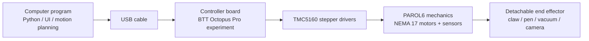

# ROBARM

ROBARM is a personal desktop robot-arm build project. The current hardware direction is a PAROL6-style 6-axis arm with 3D-printed structural parts, purchased motion hardware, a lower-cost controller workaround, and custom detachable end effectors.

The repo also includes an interactive six-axis simulator for motion planning and assembly inspection. It renders the official PAROL6 URDF link meshes and uses the upstream joint origins and axes instead of approximate procedural geometry.


## Current Direction

- Mechanical platform: [PAROL6 Desktop Robot Arm](https://github.com/Source-Robotics/PAROL6-Desktop-robot-arm)
- Print files: [official PAROL6 STL folder](https://github.com/Source-Robotics/PAROL6-Desktop-robot-arm/tree/main/STL)
- Control strategy: PC program over USB to a controller board, then stepper drivers and sensors
- Preferred controller experiment: BIGTREETECH Octopus Pro with TMC5160 drivers, instead of the expensive PAROL6 control board
- End-effector plan: detachable wrist tooling for a claw, pen holder, vacuum pickup, camera mount, and future tools
- Printer: Flashforge Adventurer 5 class printer, likely 220 x 220 x 220 mm build volume

## Repo Map

- `src/` - React + Three.js simulator source
- `public/models/parol6/` - official PAROL6 URDF, seven assembly-link meshes, and optimized previews generated from all 41 upstream printable STLs
- `public/models/electronics/` - optimized BIGTREETECH controller and driver CAD used by the parts catalog
- `scripts/smoke-test.mjs` - Playwright smoke test for canvases/screenshots
- `scripts/parts-test.mjs` - focused test for printed-part explosions, hardware filtering, nested STL search, and mobile layout
- `scripts/build-component-previews.mjs` - regenerates the lightweight GLB previews from a local clone of the official PAROL6 repository
- `docs/BOM.md` - staged order checklist, exact quantities, CAD pricing, tool list, and direct first-batch STL downloads
- `docs/ELECTRONICS.md` - controller architecture and board tradeoffs
- `docs/PRINTING_AND_CAD.md` - 3D/CAD links, print notes, and bed-fit notes
- `docs/END_EFFECTORS.md` - detachable tool changer and hand/tool ideas
- `docs/TOOLS.md` - bench tools needed for the build
- `docs/ASSEMBLY_ROADMAP.md` - staged build plan
- `docs/DIAGRAMS.md` - architecture and wiring diagrams
- `docs/HANDOFF_PROMPT.md` - copy/paste prompt for orienting another chat
- `docs/MODEL_ATTRIBUTION.md` - source, license, and implementation notes for the PAROL6 meshes
- `docs/third-party/PAROL6-GPL-3.0.txt` - upstream GPLv3 license text
- `docs/images/` - simulator screenshots committed for documentation

## Run The Simulator

```bash
npm install
npm run dev
```

Then open the Vite URL shown in the terminal.

## Verify

```bash
npm run build
npm run smoke
npm run parts-test
```

The smoke test starts a browser against a running dev server, waits for the asynchronous model loads, checks both WebGL canvases for rendered pixels, exercises motion and X-ray modes, opens representative mechanical and electronics parts, and captures desktop/mobile screenshots.

## Simulator Model

- Seven real assembly meshes: `base_link` and `L1` through `L6`
- Six revolute axes with transforms copied from the official `PAROL6.urdf`
- Tool coordinates measured from the rendered kinematic hierarchy
- Solid and X-ray inspection modes
- Per-link dimensions and masses read from the upstream mesh bounds and URDF
- Separate mechanical and electronics BOM views with required quantities, planning costs, specifications, and source links
- Manufacturer CAD for the BTT Octopus Pro and TMC5160 Pro, plus dimensioned component models for the motors, gearboxes, supply, fan, sensors, switches, and emergency stop
- Guided eight-stage assembly workflow with focused exploded parts, checks, tools, and section callouts
- Searchable exploded-component service layout with detailed inspection and fault-driven part location
- Live joint-limit, self-collision, and floor-clearance awareness for safer motion planning
- Color-coded cable-routing overlay and front, side, top, isometric, and tool camera presets
- Searchable parts catalog with one-click CSV BOM export
- Per-subassembly disassembly controls with all 41 official printable files, manual page references, selectable components, and representative 3D hardware
- Component-aware hardware lists and CSV export covering bearings, belts, pulleys, motors, gearboxes, sensors, connectors, and metric fasteners

See [model attribution](docs/MODEL_ATTRIBUTION.md) for source and redistribution notes.

## High-Level Architecture



## Notes From Planning

The Arduino Uno-compatible board we already have is useful for small tests, but it is not the right full-arm controller. It cannot safely power motors and does not have the timing headroom, pins, or driver infrastructure for a serious 6-axis stepper arm. The main control program should live on the computer; the robot controller should handle low-level step timing, homing, limit switches, emergency stop, and driver communication.

The official PAROL6 control board is the lowest-friction route, but it is expensive. The current plan is to prove out a cheaper controller stack before buying it.
