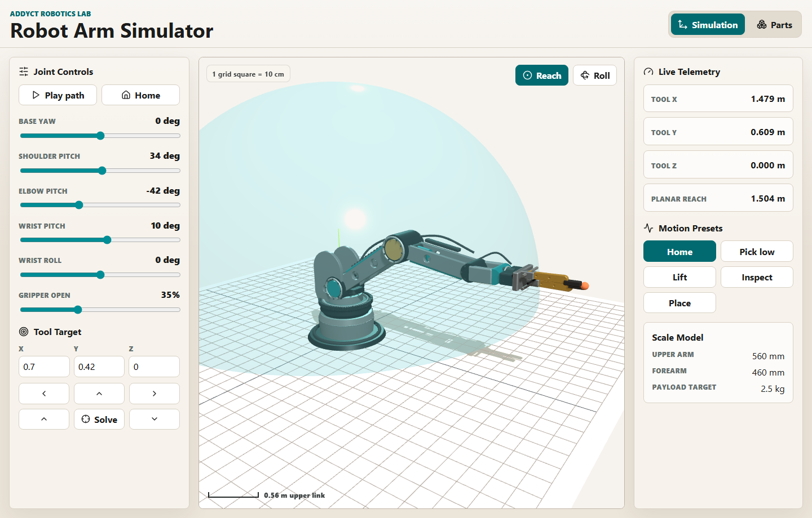
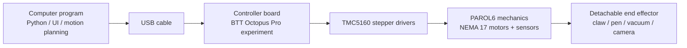

# ROBARM

ROBARM is a personal desktop robot-arm build project. The current hardware direction is a PAROL6-style 6-axis arm with 3D-printed structural parts, purchased motion hardware, a lower-cost controller workaround, and custom detachable end effectors.

The repo also includes the interactive simulator we built for planning motion, assemblies, electronics, and parts layout.



## Current Direction

- Mechanical platform: [PAROL6 Desktop Robot Arm](https://github.com/Source-Robotics/PAROL6-Desktop-robot-arm)
- Print files: [official PAROL6 STL folder](https://github.com/Source-Robotics/PAROL6-Desktop-robot-arm/tree/main/STL)
- Control strategy: PC program over USB to a controller board, then stepper drivers and sensors
- Preferred controller experiment: BIGTREETECH Octopus Pro with TMC5160 drivers, instead of the expensive PAROL6 control board
- End-effector plan: detachable wrist tooling for a claw, pen holder, vacuum pickup, camera mount, and future tools
- Printer: Flashforge Adventurer 5 class printer, likely 220 x 220 x 220 mm build volume

## Repo Map

- `src/` - React + Three.js simulator source
- `scripts/smoke-test.mjs` - Playwright smoke test for canvases/screenshots
- `docs/BOM.md` - purchase list, links, and CAD cost ranges
- `docs/ELECTRONICS.md` - controller architecture and board tradeoffs
- `docs/PRINTING_AND_CAD.md` - 3D/CAD links, print notes, and bed-fit notes
- `docs/END_EFFECTORS.md` - detachable tool changer and hand/tool ideas
- `docs/TOOLS.md` - bench tools needed for the build
- `docs/ASSEMBLY_ROADMAP.md` - staged build plan
- `docs/DIAGRAMS.md` - architecture and wiring diagrams
- `docs/images/` - simulator screenshots committed for documentation

## Run The Simulator

```bash
npm install
npm run dev
```

Then open the Vite URL shown in the terminal.

## Verify

```bash
npm run build
npm run smoke
```

The smoke test starts a browser against a running dev server and checks that the 3D canvases are not blank.

## High-Level Architecture



## Notes From Planning

The Arduino Uno-compatible board we already have is useful for small tests, but it is not the right full-arm controller. It cannot safely power motors and does not have the timing headroom, pins, or driver infrastructure for a serious 6-axis stepper arm. The main control program should live on the computer; the robot controller should handle low-level step timing, homing, limit switches, emergency stop, and driver communication.

The official PAROL6 control board is the lowest-friction route, but it is expensive. The current plan is to prove out a cheaper controller stack before buying it.
