# ROBARM Order And Print List

This is the actionable PAROL6 ordering checklist for the Octopus Pro controller path. Prices were checked on 2026-07-13 and are in Canadian dollars before tax and shipping. StepperOnline displays USD by default, so its prices below use a conservative conversion of **1 USD = 1.42 CAD**. Marketplace prices are estimates because shipping and seller selection change often.

Filament is excluded because it is already on hand.

The thumbnails in the tables are visual references. For generic commodity items, the exact specification text remains the ordering authority.

## Purchase Status

Updated 2026-07-16. These parts have already been ordered and must not be purchased again unless a delivery problem or fit problem is found.

| Status | Supplier | Part | Qty ordered | Order note |
|---|---|---|---:|---|
| **Ordered / waiting** | BIGTREETECH / BIQU |  Octopus Pro V1.0/V1.1 controller listing | 1 | Verify on arrival that the board is **V1.1 H723** and that **8 TMC5160T Pro drivers** were included. If it was board-only, drivers are still required. |
| **Ordered / waiting** | StepperOnline | 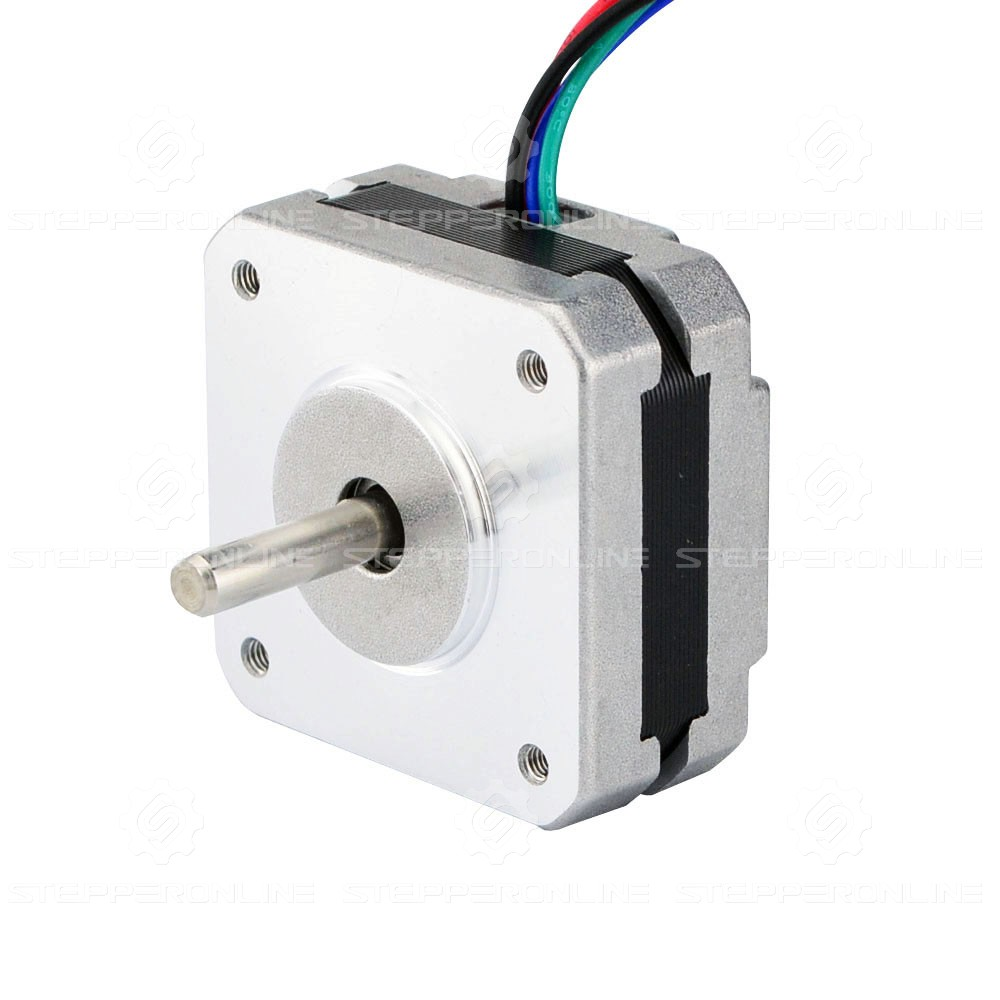 `17HS08-1004S`, NEMA 17, 16 Ncm, 20/21.5 mm body | 1 | J6 compact motor |
| **Ordered / waiting** | StepperOnline | 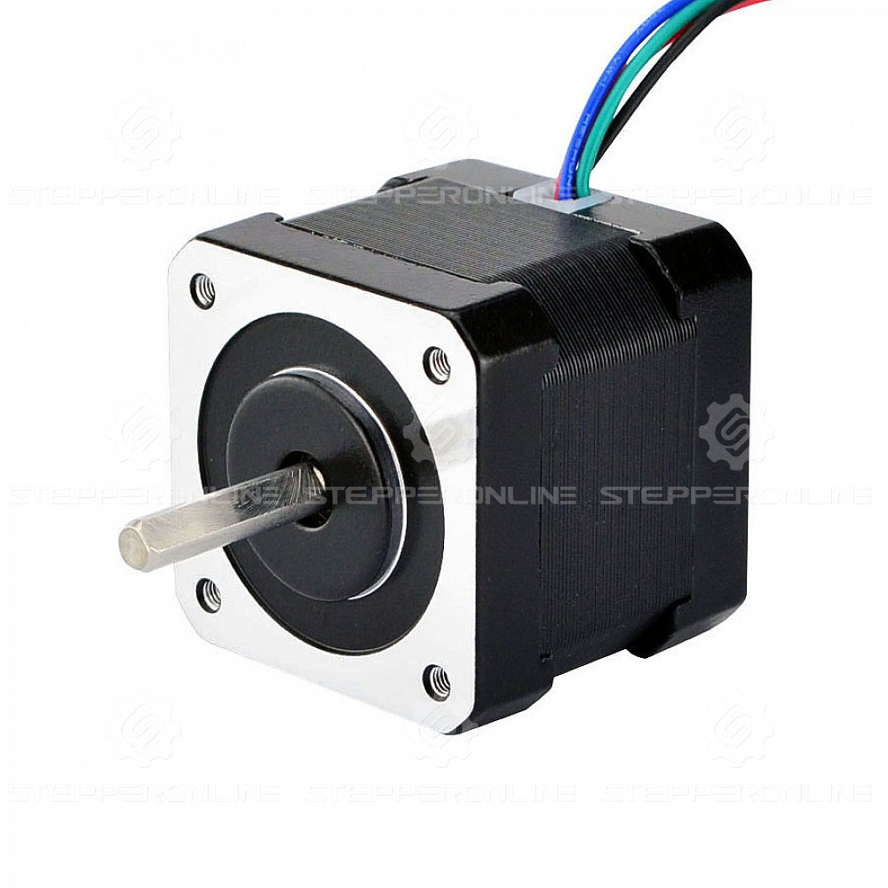 `17HS16-2004S1`, NEMA 17, 45 Ncm, 40 mm body | 3 | Mid-load motors |
| **Ordered / waiting** | StepperOnline | 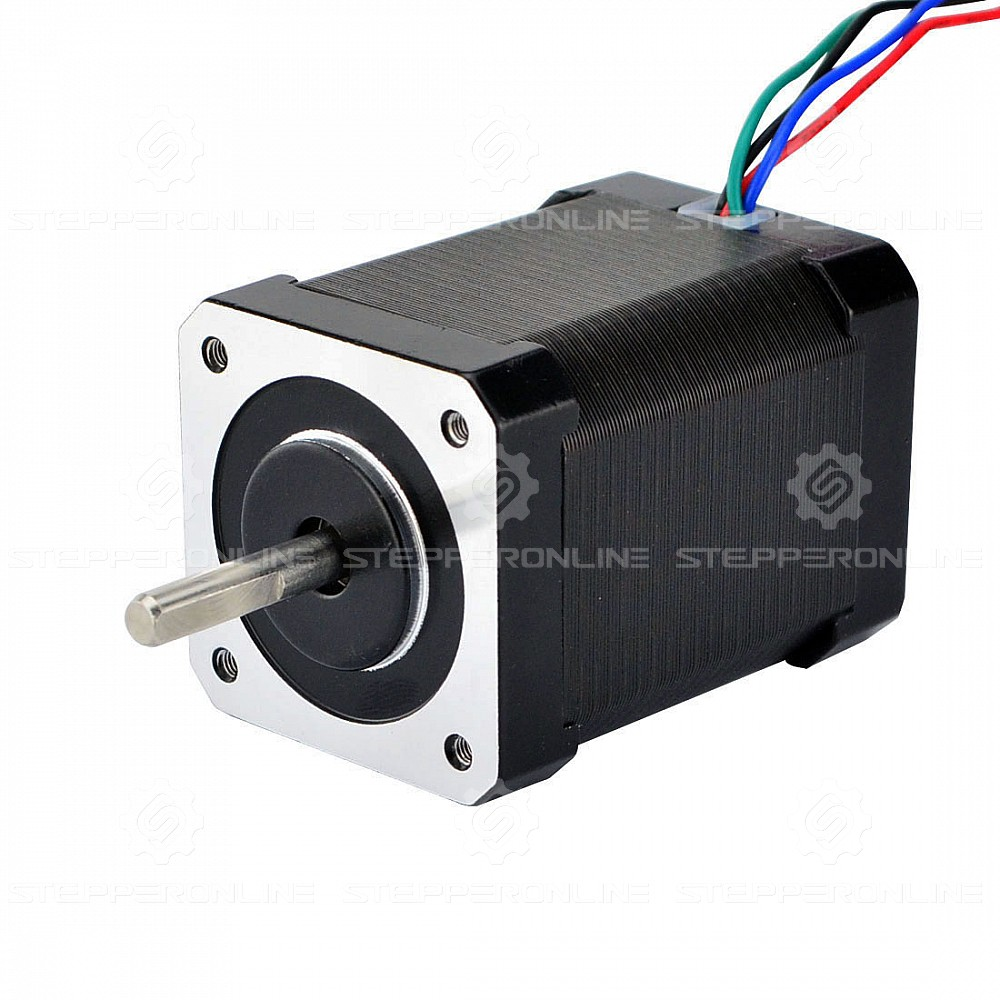 `17HS24-2104S`, NEMA 17, 65 Ncm, 60 mm body | 2 | High-load motors |
| **Ordered / waiting** | StepperOnline | 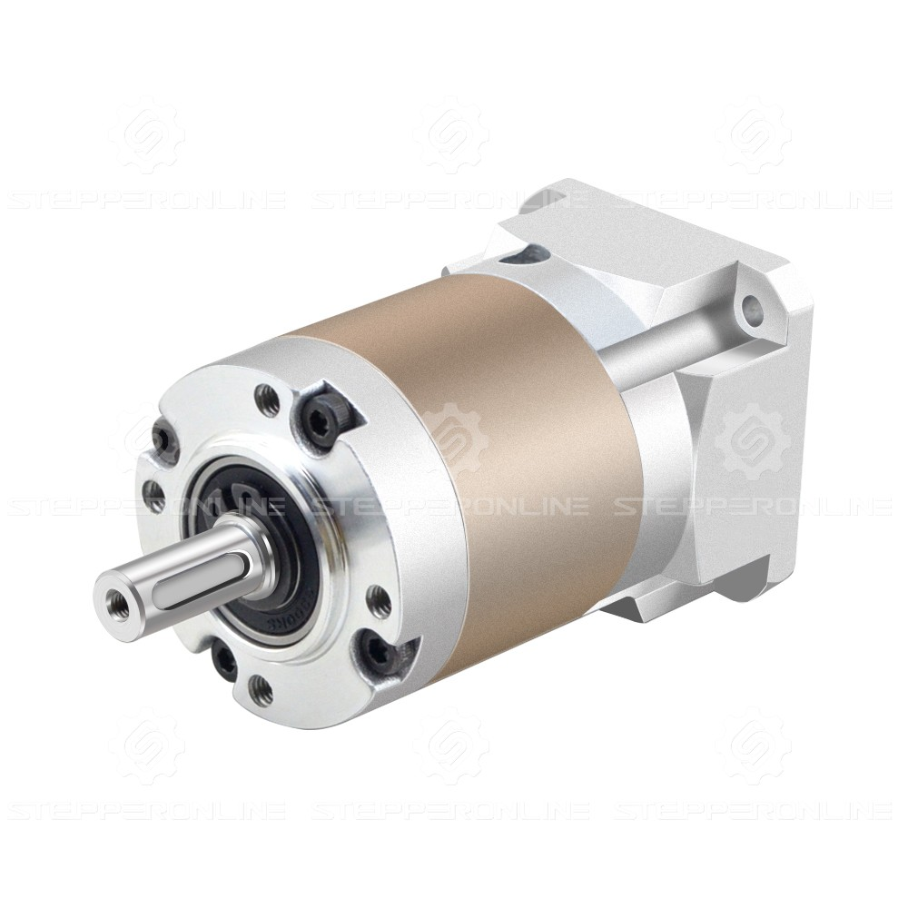 `EG17-G20`, 20:1 planetary gearbox | 2 | J1/J2 reduction |
| **Ordered / waiting** | StepperOnline | 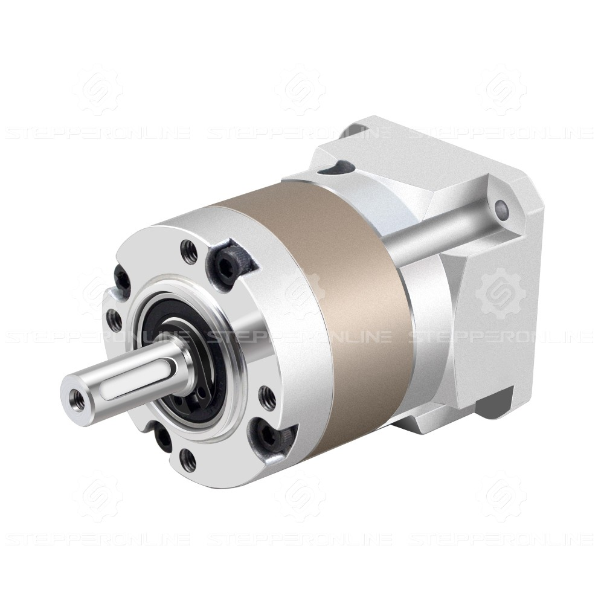 `EG17-G10`, 10:1 planetary gearbox | 1 | Lower-ratio reduction |
| **Ordered / waiting** | Mean Well / marketplace |  `EDR-120-24`, 24 V / 5 A / 120 W DIN-rail PSU | 1 | User listed the same PSU twice; tracked as one supply unless a second order is confirmed. |
| **Ordered / waiting** | AliExpress | 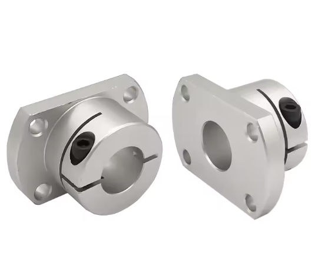 Rigid flange shaft coupler, 8 mm bore | 3 | Covers all three shaft flange couplers. |
| **Ordered / waiting** | AliExpress | 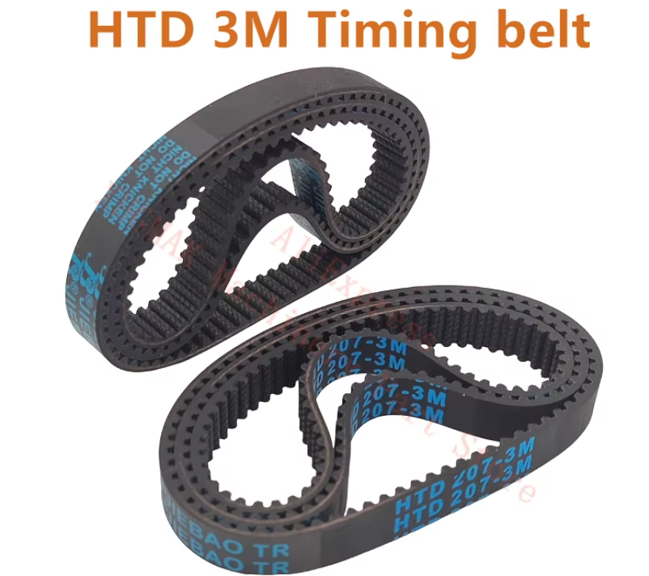 HTD3M belt, 396 mm pitch length, 6 mm width, 132 teeth | 1 | Covers the J1 belt. |
| **Ordered / waiting** | AliExpress |  HTD3M belt, 342 mm pitch length, 6 mm width, 114 teeth | 1 | Covers the J3 belt. |
| **Ordered / waiting** | AliExpress |  HTD3M belt, 201 mm pitch length, 6 mm width, 67 teeth | 1 | Covers the J4 belt. |
| **Ordered / waiting** | AliExpress |  HTD3M belt, 246 mm pitch length, 6 mm width, 82 teeth | 1 | Covers the J5 belt. |
| **Ordered / waiting** | AliExpress | 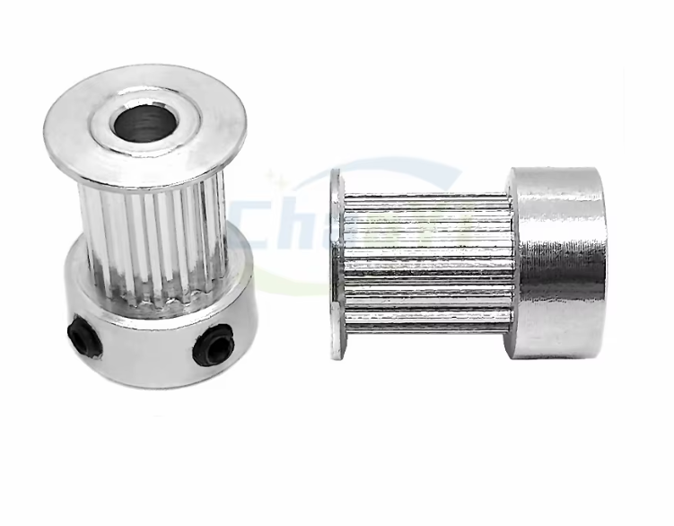 HTD3M 15T pulley, 5 mm bore, 10 mm belt-width option | 1 | Covers the J1 motor pulley. |
| **Ordered / waiting** | AliExpress |  HTD3M 12T pulley, 5 mm bore, 10 mm belt-width option | 2 | Covers the J4/J5 motor pulleys. |
| **Ordered / waiting** | AliExpress | 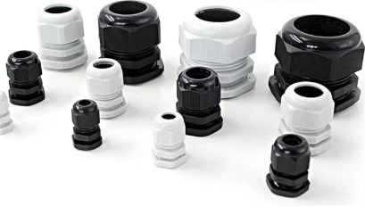 PG7 black cable gland pack | 1 pack | Covers the E-stop cable gland with spares. |
| **Ordered / waiting** | AliExpress | 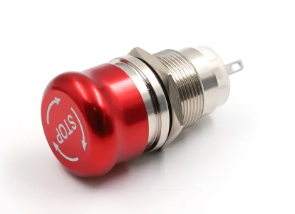 19 mm latching E-stop, `NO NC (3PINS)`, STOP mark | 1 | Correct option; wire COM + NC after multimeter check. |
| **Ordered / waiting** | AliExpress | 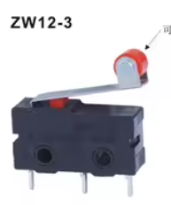 `ZW12-A-1` mini micro limit switch pack | 1 pack / 5 pcs | Covers the three switch quantity. Verify lever/body fit against the printed covers when it arrives. |
| **Ordered / waiting** | AliExpress | 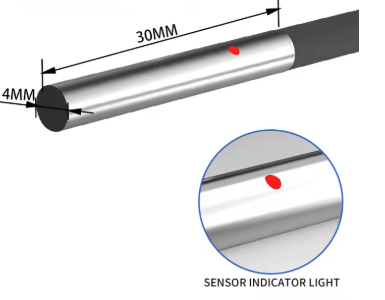 J1 homing sensor, 4 mm NPN normally open inductive sensor | 1 | Verify body size, cable exit and sensing distance before final install. |
| **Ordered / waiting** | AliExpress | 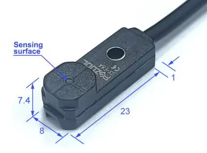 J2 homing sensor, Panasonic-style `GX-F8A` inductive sensor | 1 | Verify body size and connector/wire colours before final install. |
| **Ordered / waiting** | AliExpress | 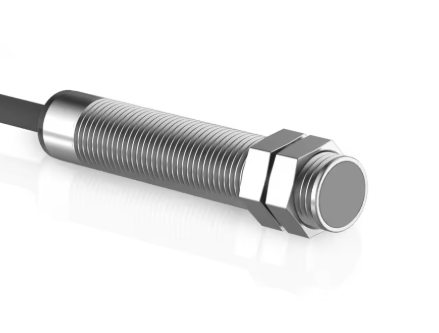 J3 homing sensor, M5 NPN normally open inductive sensor | 1 | Verify thread/body length before installing in the printed mount. |
| **Ordered / waiting** | AliExpress | 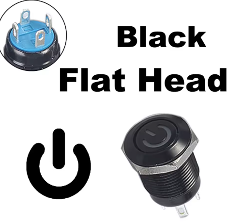 Illuminated power button, 12 mm, 3-6 V illumination | 1 | Covers the front-panel power button. |
| **Ordered / waiting** | AliExpress | 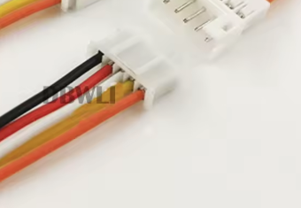 JST-PH 2.0 mm, 4-pin, 200 mm button lead | 1 | Covers the button lead. |
| **Ordered / waiting** | AliExpress | 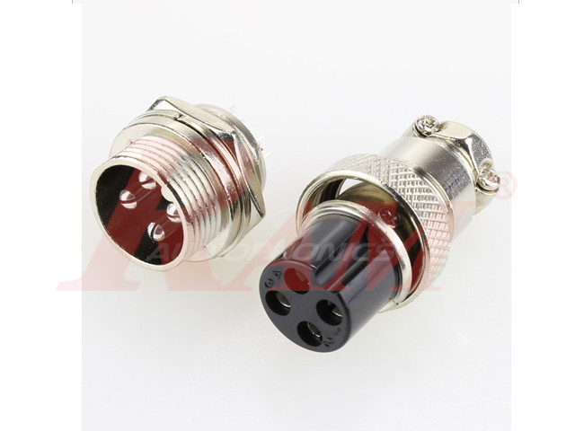 GX16 2-pin arm power connector pair | 1 pair | Covers the arm power connector. |
| **Ordered / waiting** | AliExpress | 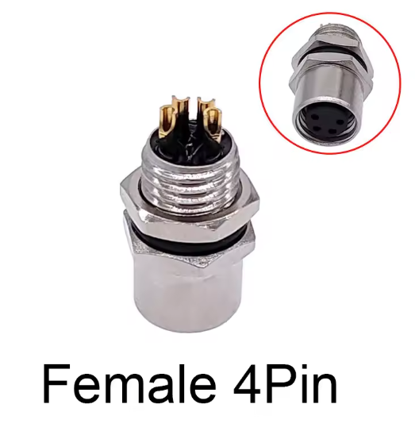 M8 female 4-pin tool connector | 1 | Covers the tool connector. |
| **Ordered / waiting** | AliExpress | 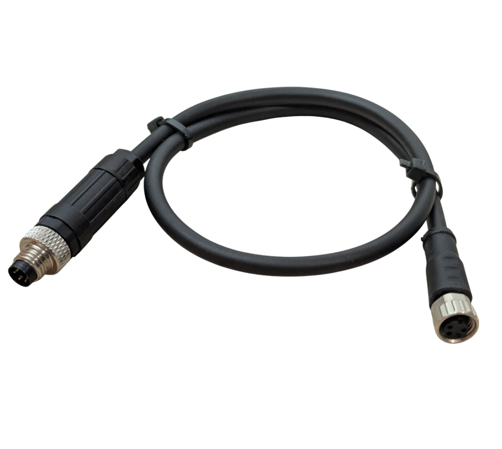 XT30 female connector | 2 | Covers one connector plus one spare. |
| **Ordered / waiting** | AliExpress | 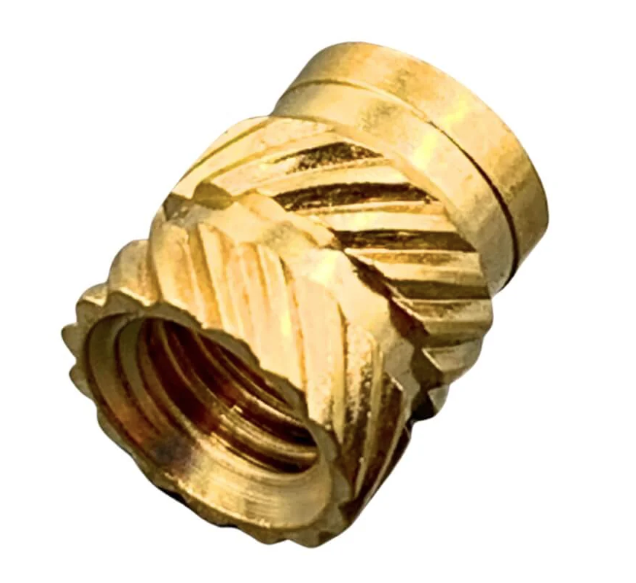 M3 brass heat-set inserts, **M3(OD4.5mm)** and **6mm 30 pcs** | 1 pack | Covers the heat-set insert order. |
| **Ordered / waiting** | Bearings Canada |  All-in-one M3 socket-head screw, nut and washer assortment | 1 kit | Covers many M3 screws, nuts and washers but not all fastener requirements. |
| **Ordered / waiting** | Harfington | 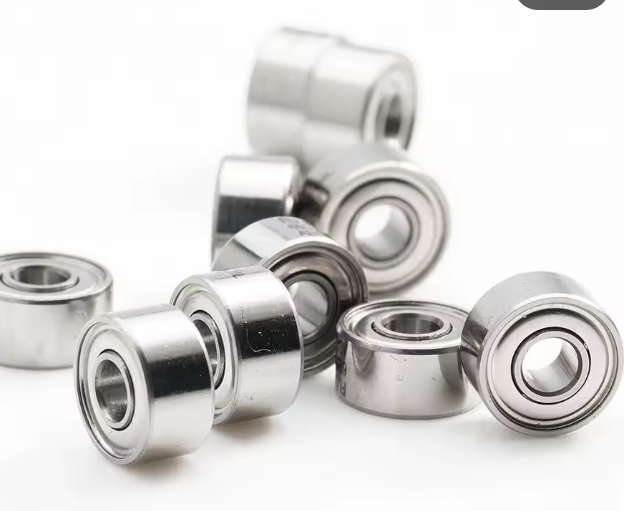 `623ZZ`, 3 x 10 x 4 mm, double shield | 1 pack / 20 pcs | Covers large tension bearings. |
| **Ordered / waiting** | Harfington |  `693ZZ`, 3 x 8 x 4 mm, double shield | 1 pack / 20 pcs | Covers small tension bearings. |
| **Ordered / waiting** | Harfington | 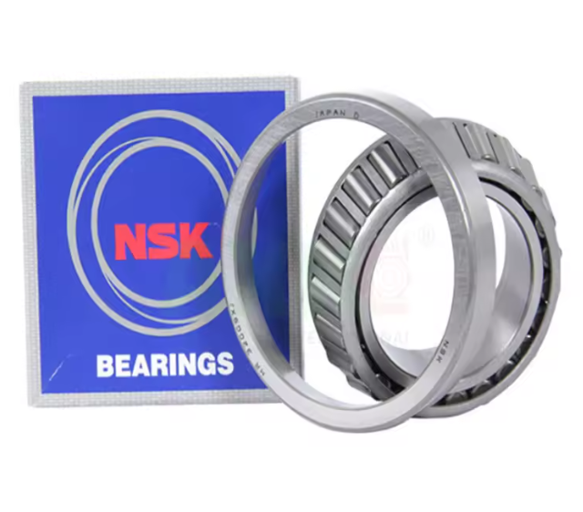 Generic `32906X`, 30 x 47 x 12 mm tapered roller bearing set | 5 | Covers J3/J4/J5 tapered-bearing quantity. |
| **Ordered / waiting** | Harfington | 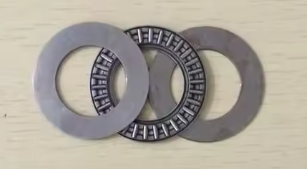 `AXK3552` with `AS3552` washers | 1 pack | Covers the J1 thrust-bearing stack, with spares. |
| **Ordered / waiting** | 123Bearing Canada |  Generic `32907`, 35 x 55 x 14 mm tapered roller bearing set | 4 | Covers J1/J2 tapered-bearing quantity using the budget option. |

**Recorded order coverage: all six motors, all three gearboxes, the PSU, controller board, all belts, all motor pulleys, all shaft couplers, all major bearings, E-stop, PG7 gland pack, heat-set inserts, homing sensors, arm connectors, M3 starter hardware and limit-switch pack.**

Controller caveat: the Octopus line must be checked when the parcel arrives. The documented ROBARM controller path needs **Octopus Pro V1.1 H723 plus eight TMC5160T Pro drivers**. A board-only order or TMC2209 bundle is not enough for the current BOM.

## Remaining Shopping List

Known still-to-order items as of 2026-07-16:

| Priority | Item | Qty | Purchase link | Notes |
|---|---|---:|---|---|
| Verify first |  TMC5160T Pro stepper drivers | 8 | [BIQU official](https://biqu.equipment/products/tmc5160-pro-v1-0) / [Amazon.ca 4-pack](https://www.amazon.ca/BIGTREETECH-TMC5160-Stepper-Ultra-Silent-Heatsink/dp/B0B3J39QQC) | Only order if the Octopus parcel does not include eight TMC5160T Pro drivers. |
| High |  Noctua `NF-A4x20 5V` fan | 1 | [Noctua product page](https://www.noctua.at/en/products/nf-a4x20-5v) | Use the 5 V version for the controller cooling plan. |
| High |  Fused AC inlet | 1 | [Amazon.ca search](https://www.amazon.ca/s?k=C14+fused+switch+inlet+5x20+UL) / [Qualtek reference](https://www.digikey.ca/en/products/detail/qualtek/723W-BEL3BR51A/23019209) | Certified switched/fused C14 inlet, 250 VAC / 10 A or higher, 5 x 20 mm fuse drawer. |
| High |  AC fuse and grounded C13 cord | 1 set | [Fuse search](https://www.amazon.ca/s?k=3.15A+time+delay+5x20mm+fuse) / [C13 cord search](https://www.amazon.ca/s?k=CSA+C13+power+cord) | 3.15 A time-delay 5 x 20 mm fuse; cord must be CSA/cUL/ETL listed. |
| High |  24 V output fuse holder and fuses | 1 set | [Amazon.ca search](https://www.amazon.ca/s?k=ATO+inline+fuse+holder+7.5A) / [Littelfuse reference](https://www.digikey.ca/en/products/detail/littelfuse-inc/028707-5U/3996914) | Inline ATO/ATC holder plus 7.5 A blade fuse and spares. |
| High |  18 AWG power wire | 2 colours | [Amazon.ca search](https://www.amazon.ca/s?k=18+AWG+stranded+copper+wire+red+black+300V) / [DigiKey reference](https://www.digikey.ca/en/products/detail/cnc-tech/1569-18-1-0500-004-1-TS/28739620) | Stranded copper, red/black, 300 V or higher insulation; avoid CCA/aluminum. |
| High |  22-24 AWG signal wire | 1 assortment | [Amazon.ca search](https://www.amazon.ca/s?k=22+AWG+stranded+copper+hookup+wire+kit+300V) / [DigiKey reference](https://www.digikey.ca/en/products/detail/adafruit-industries-llc/2976/6226990) | Flexible stranded copper, multiple colours. |
| High |  Ferrule assortment | 1 kit | [Amazon.ca search](https://www.amazon.ca/wire-end-ferrules/s?k=wire+end+ferrules) / [Adafruit reference](https://www.digikey.ca/en/products/detail/adafruit-industries-llc/5131/15650062) | Insulated bootlace ferrules covering 22-18 AWG minimum. |
| High |  Ring/fork terminal assortment | 1 kit | [Princess Auto terminal kit](https://www.princessauto.com/product/PA0008960510) | Include M3/M4 earth ring terminals. |
| High |  TS35 DIN rail | 1 | [Amazon.ca search](https://www.amazon.ca/s?k=35mm+7.5mm+DIN+rail) / [Mean Well reference](https://www.digikey.ca/en/products/detail/mean-well-usa-inc/TS35-7-5-200/22534704) | 35 x 7.5 mm, 200 mm or longer, unless your PSU order includes usable rail. |
| Medium | 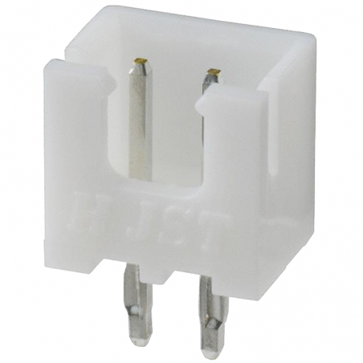 JST-PH connector assortment | 1 kit | [DigiKey Canada](https://www.digikey.ca/en/products/detail/adafruit-industries-llc/4422/11497499) | Useful for replacement button/sensor leads. |
| Medium |  USB data cable | 1 | [Amazon.ca search](https://www.amazon.ca/s?k=USB-C+data+cable) / [Octopus Pro documentation](https://github.com/bigtreetech/BIGTREETECH-OCTOPUS-Pro) | Must be data-capable, not charge-only. |
| Medium | 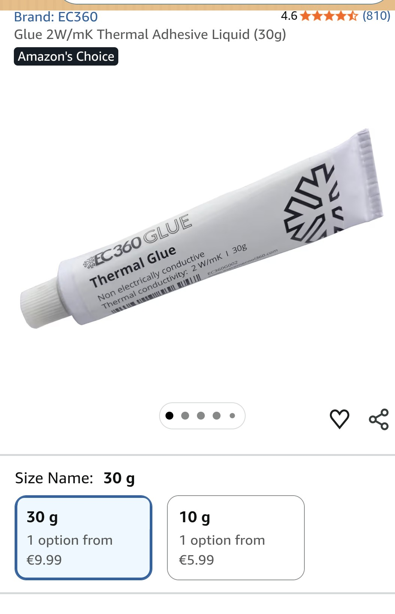 Driver thermal interface | 1 small tube | [Official PAROL6 source](https://s.click.aliexpress.com/e/_c2u86OEn) | Only needed if the driver/heatsink kit does not include pads or paste. |
| Medium |  Missing fastener fill-in | 1 batch | [Exact Fastener Order](#exact-fastener-order) | The M3 starter kit does not cover M2, M4, low-head, pan-head, countersunk or all long M3 needs. |
| Medium |  Bench consumables | 1 set | [Consumables and Small Accessories](#consumables-and-small-accessories) | Heat shrink, zip ties, blue threadlocker, solder, flux, electrical tape, labels and bearing grease. |

Defer the final control enclosure until the Octopus board, drivers, PSU, DIN rail, fuses, fan and wire bend radii are laid out in CAD. The stock PAROL6 electronics case does not fit the Octopus Pro or Mean Well PSU.

## Recommended First Order

Buy this batch first. It is enough to print fit checks and prove one motor, one limit switch, controller power, cooling, USB control, and emergency-stop wiring before committing to every gearbox and bearing.

| Buy | Exact part / specification | Qty | Link | CAD subtotal |
|---|---|---:|---|---:|
|  Controller and drivers | BIGTREETECH Octopus Pro V1.1 H723 kit, NorthPrint SKU `3991432078`; includes **8 TMC5160T Pro drivers** | 1 kit | [NorthPrint3D](https://northprint3d.ca/product/bigtreetech-btt-octopus-pro-v1-1-h723-with-tmc5160-t-pro/) | **$308.00 actual** |
|  Lower-cost controller source | Select **Type: Octopus Pro V1.1 with Chip H723** and **Size: With 8 PCs TMC5160T Pro**; BIQU SKU `1020000432*1+1050000063*8`, ships from China | 1 kit | [BIQU preselected variant](https://biqu.equipment/products/bigtreetech-octopus-pro-v1-0-chip-f446?variant=40310085812322) | **~$255 converted** ($179.56 USD) |
|  24 V supply | Mean Well `EDR-120-24`, DigiKey `1866-1441-ND`, 24 V / 5 A / 120 W | 1 | [DigiKey Canada](https://www.digikey.ca/en/products/detail/mean-well-usa-inc/EDR-120-24/7702914) | **$39.20 actual** |
|  Bench-test motor | **Already ordered:** StepperOnline `17HS16-2004S1`, NEMA 17, 45 Ncm, 42 x 42 x 40 mm | 1 of the 3 ordered | [StepperOnline](https://www.omc-stepperonline.com/nema-17-bipolar-45ncm-64oz-in-2a-42x42x40mm-4-wires-w-1m-cable-connector-17hs16-2004s1) | $0 still to order |
|  Controller fan | Noctua `NF-A4x20 5V`, 40 x 40 x 20 mm, **5 V version** | 1 | [Noctua part page](https://www.noctua.at/en/products/nf-a4x20-5v) | ~$24-$35 |
|  Limit switches | `ZW12-3` microswitches | 3 | [Official PAROL6 source](https://s.click.aliexpress.com/e/_DBq6eeF) | ~$10-$25 |
|  Emergency stop | Select **19 mm** and **NO NC (3 PINS)**; latching red mushroom panel switch. Use the COM and NC terminals | 1 | [Official PAROL6 source](https://s.click.aliexpress.com/e/_c3Bn4RR5) | ~$10-$25 |
|  E-stop cable gland | `PG7` | 1 | [Official PAROL6 source](https://s.click.aliexpress.com/e/_DdJj62p) | ~$5-$10 |
|  DIN rail | Generic TS35 rail, **35 mm x 7.5 mm**, 200 mm or longer; cut to length if needed | 1 | [Amazon.ca search](https://www.amazon.ca/s?k=35mm+7.5mm+DIN+rail) / [DigiKey reference](https://www.digikey.ca/en/products/detail/mean-well-usa-inc/TS35-7-5-200/22534704) | ~$8-$18 |
|  Fused AC inlet | Certified switched C14 inlet, IEC 60320 C14, 250 VAC, 10 A or higher, **5 x 20 mm fuse drawer**, with visible UL/cUL/CSA/ETL marking | 1 | [Amazon.ca search](https://www.amazon.ca/s?k=C14+fused+switch+inlet+5x20+UL) / [Qualtek reference](https://www.digikey.ca/en/products/detail/qualtek/723W-BEL3BR51A/23019209) | ~$10-$25 |
|  AC inlet fuse and cord | 3.15 A time-delay 5 x 20 mm fuse plus grounded C13 power cord; cord must be CSA/cUL/ETL listed | 1 each | [Fuse search](https://www.amazon.ca/s?k=3.15A+time+delay+5x20mm+fuse) / [C13 cord search](https://www.amazon.ca/s?k=CSA+C13+power+cord) | ~$15-$30 |
|  24 V output fuse | Inline ATO/ATC holder, 18-14 AWG leads, plus **7.5 A** ATO/ATC blade fuse and spares | 1 + 2 fuses | [Amazon.ca search](https://www.amazon.ca/s?k=ATO+inline+fuse+holder+7.5A) / [Littelfuse reference](https://www.digikey.ca/en/products/detail/littelfuse-inc/028707-5U/3996914) | ~$10-$22 |
|  18 AWG power wire | Flexible stranded **copper** wire, red and black, 300 V or higher insulation, at least 3 m / 10 ft each; avoid CCA/aluminum wire | 2 colours | [Amazon.ca search](https://www.amazon.ca/s?k=18+AWG+stranded+copper+wire+red+black+300V) / [DigiKey reference](https://www.digikey.ca/en/products/detail/cnc-tech/1569-18-1-0500-004-1-TS/28739620) | ~$20-$35 |
|  22-24 AWG signal wire | Flexible stranded copper hookup wire, 300 V or higher insulation, at least four colours | 1 assortment | [Amazon.ca 22 AWG search](https://www.amazon.ca/s?k=22+AWG+stranded+copper+hookup+wire+kit+300V) / [DigiKey reference](https://www.digikey.ca/en/products/detail/adafruit-industries-llc/2976/6226990) | ~$20-$35 |
|  Ferrules | Insulated bootlace ferrule assortment covering **22-18 AWG** minimum; square/hex crimp style is fine | 1 | [Amazon.ca ferrule search](https://www.amazon.ca/wire-end-ferrules/s?k=wire+end+ferrules) / [Adafruit reference](https://www.digikey.ca/en/products/detail/adafruit-industries-llc/5131/15650062) | ~$15-$35 |
|  USB data cable | USB-A to USB-C or USB-C to USB-C, confirmed data-capable | 1 | [Octopus Pro documentation](https://github.com/bigtreetech/BIGTREETECH-OCTOPUS-Pro) | ~$10-$15 |
|  M3 starter hardware | 630-piece M3 SHCS/nut/washer kit, Bearings Canada SKU `VXB0F8HMFNZK` | 1 | [Bearings Canada](https://bearingscanada.com/products/all-in-one-m3-screws-assortment-kit-with-nuts-and) | **$38.06 actual** |
|  Heat-set inserts | Select **M3(OD4.5mm)** and **6mm 30 pcs**; brass heat-set inserts for M3 screws | 1 pack | [Official PAROL6 source](https://s.click.aliexpress.com/e/_DmZR9AN) | ~$10-$20 |
|  Bench consumables | Heat shrink, zip ties, blue threadlocker, solder, flux and electrical tape | 1 set | See [Consumables](#consumables-and-small-accessories) | ~$25-$35 |

**Recommended first-order subtotal: about $590-$655 CAD before tax and shipping.**

Because the bench-test motor is already covered by the StepperOnline order, approximately **$577-$642 CAD** of this first-order list remains unpurchased, excluding any other orders not yet recorded.

This subtotal assumes no tools are needed. The minimum new-tool budget is another **$250-$350 CAD**, but only buy tools that are not already available.

Using the BIQU China-shipped controller bundle instead lowers the original parts subtotal to roughly **$537-$602 CAD**, or approximately **$524-$589 CAD still to order** after removing the purchased bench-test motor. These figures are before BIQU shipping, tax and possible import charges. The H723 board does not include an onboard fuse, so keep the fused AC inlet and 7.5 A protected 24 V branch in the order.

### Do Not Duplicate These Items

- Do not add six separate TMC5160 drivers when buying the $308 NorthPrint kit. It already includes eight.
- At BIQU, do not select `With 8 PCs TMC2209`, `With 2 PCs TMC5160T Pro`, or `With 4 PCs TMC5160T Pro` for the documented ROBARM controller path. Select the H723 / eight-TMC5160T-Pro variant.
- Do not buy the official PAROL6 controller at the same time as the Octopus Pro experiment.
- Do not buy all three gearboxes until the one-axis firmware and electrical test works.
- Do not connect exposed mains wiring on the bench. The power inlet, protective earth, fuse and enclosure are part of the first test, not optional finishing work.

### Fast-Ship Substitutions For DigiKey Control-Box Parts

The DIN rail through ferrule items in the first-order table are commodity control-box parts, so Amazon Canada, Canadian Tire, Home Depot, Princess Auto or a local electronics supplier are acceptable when the exact specification is matched. Buy by the requirement, not by brand name.

Safe substitutions:

- DIN rail: any slotted or unslotted TS35 rail, 35 x 7.5 mm, 200 mm or longer.
- 24 V DC branch protection: inline ATO/ATC holder with 18-14 AWG copper leads and a 7.5 A blade fuse.
- Low-voltage wire: stranded copper hookup wire; red/black 18 AWG for 24 V power, 22-24 AWG multi-colour for signals.
- Ferrules: insulated bootlace ferrules covering 22-18 AWG, plus a compatible ferrule crimper.
- Ring/fork terminals: insulated terminals sized for 18-22 AWG wire, with M3/M4 ring terminals for protective-earth bonding.

Use extra caution on the mains-entry parts. The fused C14 inlet, C13 cord and 5 x 20 mm AC fuse may come from Amazon, but only if the listing and the part itself show a real UL, cUL, CSA or ETL safety mark and the ratings are at least 250 VAC / 10 A for the inlet and cord. Do not use a no-name AC inlet with unclear markings inside a mains-powered enclosure.

## Physical Fit Status

**The Octopus Pro electronics are not a drop-in fit for the stock PAROL6 electronics enclosure.** The official `Electronics_case_v1_1.STL` has an outer mesh envelope of approximately **109 x 59.8 x 130.5 mm**. Its usable cavity is smaller.

| Component group | Stock printed-part fit | Status |
|---|---|---|
|  NEMA 17 motors and EG17 gearboxes | The listed models and body lengths follow the official PAROL6 BOM | Expected to fit; verify shaft, cable exit and flange before closing each joint |
|  Belts, pulleys, couplers and bearings | Exact official sizes are listed | Expected to fit when the exact dimensions and bearing codes are purchased |
|  ZW12-3 switches and three inductive sensors | Official form factors and source links | Expected to fit; marketplace substitutes can have different bodies or cable exits |
|  Noctua 40 x 40 x 20 mm fan | Official fan cover is approximately 53 x 59.8 x 22.5 mm and the fan uses standard 32 mm hole spacing | Expected to fit; print the fan cover first |
|  E-stop, illuminated button, GX16, M8, XT30 and PG7 | Printed openings were designed around the official BOM parts | Expected only when the linked body/thread sizes are matched; print-fit before wiring |
|  BTT Octopus Pro + drivers | Board is approximately 162 x 100 mm before cable clearance | **Does not fit** the stock 109 mm-wide electronics case and has no matching mounting bosses |
|  Mean Well `EDR-120-24` | 40 x 125.2 x 113.5 mm, plus DIN rail and terminal clearance | **External by design**; the upstream manual feeds 24 V into the arm and does not place the PSU inside the stock case |
|  Fused C14 inlet, branch fuse and DIN rail | Not part of the upstream printed enclosure design | **No stock mounting provisions** |

Plan on a **separate custom control enclosure** for the Octopus Pro, TMC5160 drivers, Mean Well supply, fuses, DIN rail, mains inlet and cooling. The [upstream assembly manual](https://github.com/Source-Robotics/PAROL6-Desktop-robot-arm/blob/main/Building%20instructions/Parol%20building%20instructions.pdf) shows the original custom controller sliding under the printed case and external 24 V entering through the arm connector. Keep mains-voltage parts out of the printed rotating base. The stock electronics-case STL may still be needed as part of the physical base/cable structure, but it must not be treated as the Octopus controller box.

Do not purchase a generic control enclosure until the board, populated driver height, PSU, terminal bend radii and fan layout have been arranged in CAD. A grounded metal or appropriately certified electrical enclosure is preferred for the mains-powered supply.

## Full Arm Electronics And Motion

These are the final full-arm quantities. Items already included in the first order are repeated so this table remains a complete BOM.

| System | Part number / exact specification | Full qty | Unit CAD | Full subtotal | Order link |
|---|---|---:|---:|---:|---|
|  Controller | BTT Octopus Pro V1.1 H723 + 8 x TMC5160T Pro kit | 1 kit | $308.00 | $308.00 | [NorthPrint3D](https://northprint3d.ca/product/bigtreetech-btt-octopus-pro-v1-1-h723-with-tmc5160-t-pro/) |
|  J6 motor | StepperOnline `17HS08-1004S`, 16 Ncm, 42 x 42 x 21.5 mm | 1 | ~$11.35 | ~$11.35 | [StepperOnline](https://www.omc-stepperonline.com/nema-17-bipolar-1-8deg-16ncm-22-6oz-in-1a-3-7v-42x42x20mm-4-wires-17hs08-1004s) |
|  Mid-load motors | StepperOnline `17HS16-2004S1`, 45 Ncm, 42 x 42 x 40 mm | 3 | ~$12.96 | ~$38.90 | [StepperOnline](https://www.omc-stepperonline.com/nema-17-bipolar-45ncm-64oz-in-2a-42x42x40mm-4-wires-w-1m-cable-connector-17hs16-2004s1) |
|  High-load motors | StepperOnline `17HS24-2104S`, 65 Ncm, 42 x 42 x 60 mm | 2 | ~$18.80 | ~$37.60 | [StepperOnline](https://www.omc-stepperonline.com/nema-17-bipolar-1-8deg-65ncm-92oz-in-2-1a-3-36v-42x42x60mm-4-wires-17hs24-2104s) |
|  Precision gearboxes | StepperOnline `EG17-G20`, 20:1, 20 arc-min backlash | 2 | ~$51.63 | ~$103.30 | [StepperOnline](https://www.omc-stepperonline.com/eg-series-planetary-gearbox-gear-ratio-20-1-backlash-20-arc-min-for-nema-17-stepper-motor-eg17-g20) |
|  Precision gearbox | StepperOnline `EG17-G10`, 10:1, 15 arc-min backlash | 1 | ~$41.55 | ~$41.55 | [StepperOnline](https://www.omc-stepperonline.com/eg-series-planetary-gearbox-gear-ratio-10-1-backlash-15-arc-min-for-nema-17-stepper-motor-eg17-g10) |
|  Power supply | Mean Well `EDR-120-24`, 24 V / 5 A / 120 W | 1 | $39.20 | $39.20 | [DigiKey Canada](https://www.digikey.ca/en/products/detail/mean-well-usa-inc/EDR-120-24/7702914) |
|  Cooling | Noctua `NF-A4x20 5V`, 40 mm, 5 V | 1 | ~$24-$35 | ~$24-$35 | [Noctua](https://www.noctua.at/en/products/nf-a4x20-5v) |
|  Mechanical switches | `ZW12-3` | 3 | pack estimate | ~$10-$25 | [Official PAROL6 source](https://s.click.aliexpress.com/e/_DBq6eeF) |
|  J1 homing sensor | 4 mm, NPN, normally open inductive sensor | 1 | ~$10-$20 | ~$10-$20 | [Official PAROL6 source](https://s.click.aliexpress.com/e/_c40MRkk5) |
|  J2 homing sensor | Panasonic-style `GX-F8A` inductive sensor | 1 | ~$10-$20 | ~$10-$20 | [Official PAROL6 source](https://s.click.aliexpress.com/e/_c4VxLtW3) |
|  J3 homing sensor | M5, NPN, normally open inductive sensor | 1 | ~$10-$20 | ~$10-$20 | [Official PAROL6 source](https://s.click.aliexpress.com/e/_c3zGvxrP) |
|  Emergency stop | **19 mm**, latching red mushroom, `NO NC (3 PINS)` option; wire COM + NC | 1 | ~$10-$25 | ~$10-$25 | [Official PAROL6 source](https://s.click.aliexpress.com/e/_c3Bn4RR5) |

**Main controller, motors, gearboxes, supply and fan: about $605-$615 CAD before tax and shipping.** Sensors and safety parts add roughly **$50-$110 CAD**.

## Mechanical Transmission And Bearings

The option text in this table is the checkout requirement. AliExpress product pages contain many dimensions under one listing; opening the correct page is not enough unless the listed option is selected.

| Part | Exact checkout selection | Arm qty | What to order | Verified CAD | Link |
|---|---|---:|---|---:|---|
|  J1 belt | Closed-loop `HTD 3M`, **396 mm pitch length**, **6 mm width**; 132 teeth | 1 | 1 belt | seller varies | [AliExpress item `32240801142`](https://www.aliexpress.com/item/32240801142.html) |
|  J3 belt | Closed-loop `HTD 3M`, **342 mm pitch length**, **6 mm width**; 114 teeth | 1 | 1 belt | seller varies | [AliExpress item `1005007574237593`](https://www.aliexpress.com/item/1005007574237593.html) |
|  J4 belt | Closed-loop `HTD 3M`, **201 mm pitch length**, **6 mm width**; 67 teeth | 1 | 1 belt | seller varies | [AliExpress item `1005004758645960`](https://www.aliexpress.com/item/1005004758645960.html) |
|  J5 belt | Closed-loop `HTD 3M`, **246 mm pitch length**, **6 mm width**; 82 teeth | 1 | 1 belt | seller varies | [AliExpress item `32232487083`](https://www.aliexpress.com/item/32232487083.html) |
|  J4/J5 motor pulleys | `HTD3M`, **12 teeth**, **5 mm bore**, option for **10 mm belt width**, double-flanged, set-screw type | 2 | 2 identical pulleys | seller varies | [AliExpress item `1005005594947630`](https://www.aliexpress.com/item/1005005594947630.html) |
|  J1 motor pulley | `HTD3M`, **15 teeth**, **5 mm bore**, option for **10 mm belt width**, double-flanged, set-screw type | 1 | 1 pulley | seller varies | [AliExpress item `32855479210`](https://www.aliexpress.com/item/32855479210.html) |
|  Shaft flange couplers | Rigid flange hub, **8 mm bore**, 32 mm flange OD, 16 mm hub OD, 13 mm overall height, four M4 mounting holes on approximately 24 mm opposite-hole spacing | 3 | 3 identical couplers | seller varies | [AliExpress item `1005006306920922`](https://www.aliexpress.com/item/1005006306920922.html) |
|  J1 thrust bearing | `AXK3552`, 35 x 52 x 2 mm cage plus **two `AS3552` 1 mm washers**; assembled stack 35 x 52 x 4 mm | 1 stack | 1 listing; package contains 5 bearings + 10 washers | **$15.78** | [Harfington `p-1460963`](https://www.harfington.com/en-ca/products/p-1460963) |
|  J3/J4/J5 tapered bearings | Official: NSK `HR32906J`; 30 mm bore, 47 mm OD, 12 mm total width, 12 mm cone, 9 mm cup | 5 | **5 complete cone-and-cup bearings** | exact NSK: quote | [NSK specification](https://www.oss.nsk.com/products/bearings/roller-bearings/tapered-roller-bearings/metric-series-tapered-roller-bearings/hr32906j-apn.html) |
|  Budget `HR32906J` substitute | Generic `32906X`, 30 x 47 x 12 mm complete cone-and-cup set; dimensionally compatible but not NSK-branded | 5 | Select `1 / 32906X`, set cart quantity to **5** | **$14.74 each / $73.70** | [Harfington preselected variant](https://www.harfington.com/en-ca/products/p-1694548?variant=46634238345465) |
|  J1/J2 tapered bearings | Official spec: NSK `HR32907J`; 35 mm bore, 55 mm OD, 14 mm total width, 14 mm cone, 11.5 mm cup | 4 | **4 complete cone-and-cup bearings** | exact NSK: quote | [NSK specification](https://www.oss.nsk.com/products/bearings/roller-bearings/tapered-roller-bearings/metric-series-tapered-roller-bearings/hr32907j-apn.html) |
|  Branded `HR32907J` substitute | JTEKT/KOYO `32907JR-2`, 35 x 55 x 14 mm complete cone-and-cup set; same boundary dimensions as the official NSK size | 4 | Set cart quantity to **4** | **$43.87 each / $175.48** | [123Bearing Canada JTEKT/KOYO](https://www.123bearing.ca/bearing-housing/roller-bearing/tapered/32907jr-2-jtekt) |
|  Budget `HR32907J` substitute | Generic `32907`, 35 x 55 x 14 mm complete cone-and-cup set; dimensionally compatible but not NSK-branded | 4 | Set cart quantity to **4** | **$32.03 each / $128.12** | [123Bearing Canada generic](https://www.123bearing.ca/bearing-housing/roller-bearing/tapered/32907) |
|  Small tension bearings | Plain, non-flanged `693ZZ` / `693-2Z`, **3 x 8 x 4 mm**, double metal shield | 20 | 1 pack of 20 | **$18.00** | [Harfington 20-pack](https://www.harfington.com/en-ca/products/p-1813984) |
|  Large tension bearings | Plain, non-flanged `623ZZ` / `623-2Z`, **3 x 10 x 4 mm**, double metal shield | 20 | 1 pack of 20 | **$11.00** | [Harfington 20-pack](https://www.harfington.com/en-ca/products/p-1625137) |

Important bearing checks:

- `693ZZ` is the correct standard designation for 3 x 8 x 4 mm. **Do not buy `MR83ZZ`**, which is normally 3 x 8 x 3 mm.
- Do not buy `F693ZZ` or `F623ZZ`; the `F` versions have a flange and are not the plain bearings shown in the PAROL6 tension stack.
- Every tapered-bearing item must include both the cone/roller assembly and the separate outer cup. Do not buy a cone-only or cup-only listing.
- The JTEKT/KOYO `32907JR-2` choice is the preferred orderable replacement for the old Motion Canada quote path. JTEKT confirms the 35 x 55 x 14 mm boundary dimensions, and 123Bearing listed it in stock at the checked price.
- The generic `32906X` and `32907` choices match the required boundary dimensions but are not represented as equal to NSK's verified load ratings or quality. Use exact NSK parts if a Canadian supplier can provide a reasonable quote.
- Buy all bearings of a given size from the same listing/batch. Do not mix an NSK and generic bearing in the same opposed joint pair.

Using the generic tapered-bearing options, the mechanical transmission and bearing estimate is now approximately **$285-$370 CAD** before tax and shipping. The original AliExpress `HR32906J` and 10-pack tension-bearing listings are no longer recommended because their one-per-customer limits cannot satisfy the BOM quantities.

## Connectors, Wiring And Safety Accessories

| Item | Exact specification / part number | Qty to order | Estimated CAD | Link |
|---|---|---:|---:|---|
|  Illuminated power button | 12 mm panel button, 3-6 V illumination | 1 | ~$5-$15 | [Official PAROL6 source](https://s.click.aliexpress.com/e/_DBpZV3h) |
|  Button lead | JST-PH 2.0 mm, 4 pin, 200 mm | 1 | ~$5-$10 | [Official PAROL6 source](https://s.click.aliexpress.com/e/_DeObQ1D) |
|  JST-PH connector assortment | Adafruit `4422`, 2.0 mm pitch housings and contacts; useful for replacement button/sensor leads | 1 kit | $13.43 | [DigiKey Canada](https://www.digikey.ca/en/products/detail/adafruit-industries-llc/4422/11497499) |
|  Arm power connector | GX16, 2 pin, male and female pair | 1 pair | ~$5-$15 | [Official PAROL6 source](https://s.click.aliexpress.com/e/_DcHjMfN) |
|  Tool connector | M8 female sensor connector, 4 pin | 1 | ~$10-$25 | [Official PAROL6 source](https://s.click.aliexpress.com/e/_DDQz9iP) |
|  Controller power connector | XT30 female | 1 plus 1 spare | ~$5-$15 | [Official PAROL6 source](https://s.click.aliexpress.com/e/_DllR7eL) |
|  E-stop gland | PG7 | 1 plus 1 spare | ~$5-$10 | [Official PAROL6 source](https://s.click.aliexpress.com/e/_DdJj62p) |
|  Heat-set inserts | Select **M3(OD4.5mm)** and **6mm 30 pcs**; brass heat-set inserts for M3 screws | 1 pack | ~$10-$20 | [Official PAROL6 source](https://s.click.aliexpress.com/e/_DmZR9AN) |
|  Driver thermal interface | Non-conductive thermal paste or thermal adhesive; only if not included with drivers/heatsinks | 1 small tube | ~$8-$15 | [Official PAROL6 source](https://s.click.aliexpress.com/e/_c2u86OEn) |
|  Power wire | 18 AWG stranded **copper**, red/black, 300 V or higher insulation; do not buy CCA/aluminum wire | 3-5 m each | ~$20-$40 | [Amazon.ca search](https://www.amazon.ca/s?k=18+AWG+stranded+copper+wire+red+black+300V) / [DigiKey reference](https://www.digikey.ca/en/products/detail/cnc-tech/1569-18-1-0500-004-1-TS/28739620) |
|  Motor/signal wire | 22-24 AWG flexible stranded copper, at least 6 colours, 300 V or higher insulation | 5-10 m total | ~$20-$50 | [Amazon.ca search](https://www.amazon.ca/s?k=22+AWG+stranded+copper+hookup+wire+kit+300V) / [DigiKey reference](https://www.digikey.ca/en/products/detail/adafruit-industries-llc/2976/6226990) |
|  Ferrules | Insulated bootlace ferrules covering 22-18 AWG minimum | 1 assortment | ~$15-$35 | [Amazon.ca search](https://www.amazon.ca/wire-end-ferrules/s?k=wire+end+ferrules) / [Adafruit reference](https://www.digikey.ca/en/products/detail/adafruit-industries-llc/5131/15650062) |
|  Ring/fork terminals | Insulated 18-22 AWG; include M3/M4 earth ring terminals | 1 assortment | ~$15-$30 | [Princess Auto terminal kit](https://www.princessauto.com/product/PA0008960510) |
|  24 V branch protection | Inline ATO/ATC holder and 7.5 A blade fuse; keep spare fuses | 1 holder + 3 fuses | ~$10-$22 | [Amazon.ca search](https://www.amazon.ca/s?k=ATO+inline+fuse+holder+7.5A) / [Littelfuse reference](https://www.digikey.ca/en/products/detail/littelfuse-inc/028707-5U/3996914) |
|  AC entry | Certified switched/fused C14 inlet, 3.15 A time-delay 5 x 20 mm fuse, CSA/cUL/ETL C13 grounded cord | 1 set | ~$25-$45 | [Amazon.ca inlet search](https://www.amazon.ca/s?k=C14+fused+switch+inlet+5x20+UL) / [Qualtek reference](https://www.digikey.ca/en/products/detail/qualtek/723W-BEL3BR51A/23019209) |
|  DIN rail | TS35, 35 x 7.5 mm, 200 mm or longer | 1 | ~$8-$18 | [Amazon.ca search](https://www.amazon.ca/s?k=35mm+7.5mm+DIN+rail) / [Mean Well reference](https://www.digikey.ca/en/products/detail/mean-well-usa-inc/TS35-7-5-200/22534704) |
|  USB cable | Data-capable USB-C cable for Octopus Pro | 1 plus 1 spare | ~$10-$20 | [Controller documentation](https://github.com/bigtreetech/BIGTREETECH-OCTOPUS-Pro) |

The Mean Well supply has exposed mains terminals. Protective earth must be bonded correctly, live terminals must be enclosed, and the AC input must be fused and strain-relieved. Have a qualified person inspect the mains side if there is any uncertainty.

For the three-pin E-stop, do not trust terminal position or colour alone. Identify COM and NC with a multimeter: they must have continuity while the button is released and become open-circuit while it is latched down. The emergency-stop action must remove motor power or the hardware driver-enable path rather than depend only on software.

## Exact Fastener Order

The required column is copied from the official PAROL6 BOM. The order column adds practical spares. Standard socket screws are DIN 912 / ISO 4762 unless another head type is stated.

| Fastener | Required | Order | Notes / source |
|---|---:|---:|---|
|  M4 x 10 mm socket head | 20 | 25 | [Spool3D metric screws](https://spool3d.ca/m4-socket-head-cap-screw-din912-stainless-steel/) |
|  M3 x 8 mm low-head socket, 2 mm head height | 10 | 15 | Do not substitute standard 3 mm head height; [low-head example](https://www.hardwarespecialty.com/Product/1362908) |
|  M3 x 8 mm socket head | 50 | 60 | [Spool3D M3 screws](https://spool3d.ca/m3-socket-head-cap-screw-din912-stainless-steel/) |
|  M3 x 14 mm socket head | 30 | 40 | [Spool3D M3 screws](https://spool3d.ca/m3-socket-head-cap-screw-din912-stainless-steel/) |
|  M3 hex nuts | 10 | 25 | Starter assortment includes extras |
|  M3 x 25 mm socket head | 10 | 15 | Starter assortment includes 20 |
|  M2 x 10 mm socket head | 10 | 15 | Buy as an individual bag |
|  M3 x 16 mm socket head | 10 | 15 | Starter assortment includes 25 |
|  M3 x 6 mm pan-head Phillips | 10 | 15 | Head type matters |
|  M3 x 12 mm socket head | 30 | 40 | Starter assortment includes 25; add a small bag |
|  M3 x 35 mm socket head | 10 | 15 | [Spool3D M3 screws](https://spool3d.ca/m3-socket-head-cap-screw-din912-stainless-steel/) |
|  M4 x 16 mm socket head | 30 | 40 | [Spool3D M4 screws](https://spool3d.ca/m4-socket-head-cap-screw-din912-stainless-steel/) |
|  M4 x 14 mm socket head | 10 | 15 | [Spool3D M4 screws](https://spool3d.ca/m4-socket-head-cap-screw-din912-stainless-steel/) |
|  M4 x 50 mm socket head | 10 | 15 | [Spool3D M4 screws](https://spool3d.ca/m4-socket-head-cap-screw-din912-stainless-steel/) |
|  M3 x 15 mm countersunk / tapered-head | 2 | 5 | Confirm head profile against the printed part |

Start with the [630-piece M3 kit](https://bearingscanada.com/products/all-in-one-m3-screws-assortment-kit-with-nuts-and), then fill the missing M3 x 14, M3 x 35, low-head, pan-head, countersunk, M2 and M4 lengths individually. Budget **$100-$160 CAD** for the complete padded fastener order.

## Tools To Buy If Missing

| Priority | Tool | Suggested product / specification | CAD |
|---|---|---|---:|
| Required |  Metric hex keys | 1.5-6 mm minimum; [Mastercraft 42-piece set](https://www.canadiantire.ca/en/pdp/mastercraft-sae-metric-hex-key-set-allen-wrench-set-rust-resistant-cr-v-steel-42-pc-0589699p.html) | $27.99 |
| Required |  Digital multimeter | Must measure DC voltage, resistance and continuity; [Mastercraft autoranging meter](https://www.canadiantire.ca/en/pdp/autoranging-digital-multimeter-0520052p.0520052.html) | ~$40-$74 |
| Required |  Digital caliper | 0.01 mm resolution; [MAXIMUM 6-inch caliper](https://www.canadiantire.ca/en/pdp/maximum-professional-digital-caliper-with-lcd-screen-mm-inch-conversion-switch-automatic-shutoff-6-in-0581639p.html) | $54.99 |
| Required |  Temperature-controlled soldering iron | Adjustable iron or station; [Weller SP23LK example](https://www.canadiantire.ca/en/pdp/weller-sp23lk-30w-adjustable-temperature-soldering-iron-kit-7-pc-0586309p.html) | ~$42.99 |
| Required |  Wire stripper | 20-30 AWG plus a separate 10-20 AWG stripper if needed; [Mastercraft example](https://www.canadiantire.ca/en/cat/tools-hardware/electrical/electrical-tools-accessories/wire-strippers-cutters-crimpers-DC0001757.html) | ~$11-$30 |
| Required |  Flush cutters | Small electronics/filament flush cutter | ~$10-$20 |
| Required |  Safety glasses | CSA-rated eye protection | ~$10-$20 |
| Strongly recommended |  Ferrule crimper | Ratcheting square ferrule crimper, 22-10 AWG; [Klein `34055`](https://www.digikey.ca/en/products/detail/klein-tools-inc/34055/24627409) | ~$53 |
| Strongly recommended |  JST/open-barrel crimper | [Adafruit `5682`](https://www.digikey.ca/en/products/detail/adafruit-industries-llc/5682/18627504), micro connector crimp pliers for 18-32 AWG contacts | $59.62 |
| Strongly recommended |  Small needle-file set | Flat, round and half-round files for printed fits | ~$15-$25 |
| Strongly recommended |  Deburring tool / hobby knife | Clean holes and printed edges | ~$10-$20 |
| Strongly recommended |  Small bench vise or clamps | Press bearings and hold solder work without loading printed parts unevenly | ~$30-$60 |
| Strongly recommended |  Metric drill set | 2-6 mm range for cleaning printed holes by hand | ~$20-$40 |
| Helpful |  M3/M4/M5 tap set | Clean or create threads; do not power-tap printed parts | ~$20-$40 |
| Helpful |  Heat-set insert tip | M3 tip compatible with the soldering iron | ~$15-$25 |
| Helpful |  Helping hands / PCB holder | Holds connectors and wires while soldering | ~$20-$40 |

Expected cost if starting with no tools: **about $250-$350 CAD for the required set**, or **$400-$550 CAD** including the strongly recommended crimping and holding tools.

## Consumables And Small Accessories

Order these with the first or second batch:

| Item | Suggested quantity | Estimated CAD |
|---|---:|---:|
|  Heat-shrink assortment, 2:1 or 3:1 | 1 box | $12-$20 |
|  Small and medium zip ties | 100 each | $10-$20 |
|  Blue removable threadlocker, medium strength | 1 small bottle | $10-$18 |
|  Rosin-core electronics solder and flux pen | 1 each | $20-$35 |
|  Electrical tape | 1 roll | $5-$10 |
|  90%+ isopropyl alcohol and lint-free wipes | 1 set | $10-$18 |
|  NLGI #2 bearing grease suitable for steel rolling bearings | 1 small tube | $10-$20 |
|  Flexible cable sleeve or spiral wrap | 3-5 m | $15-$30 |
|  Adhesive cable tie mounts | 25-50 | $8-$15 |
|  Wire labels or heat-shrink labels | 1 set | $10-$25 |
|  M3/M4 flat washers and nyloc nuts for prototypes | 1 assortment | $15-$25 |
|  Spare 3.15 A AC fuses and 7.5 A DC fuses | 3 each | $5-$12 |

## First STL Print Batch

Download the [complete official repository ZIP](https://github.com/Source-Robotics/PAROL6-Desktop-robot-arm/archive/refs/heads/main.zip) once, then start with these smaller parts. They expose hole sizing, thin walls, pulley teeth and insert fit before committing to the long upper arm.

| Print first | Why | Direct STL download |
|---|---|---|
|  Fan cover | Checks 40 mm fan hole spacing and M3 fit | [fan_cover.STL](https://raw.githubusercontent.com/Source-Robotics/PAROL6-Desktop-robot-arm/main/STL/BASE/fan_cover.STL) |
|  J2 limit-switch cover | Small fast print for wall and screw-hole calibration | [J2_limit_switch_cover.STL](https://raw.githubusercontent.com/Source-Robotics/PAROL6-Desktop-robot-arm/main/STL/SHOULDER/J2_limit_switch_cover.STL) |
|  J4 limiter | Small mechanical fit check | [J4_limiter.STL](https://raw.githubusercontent.com/Source-Robotics/PAROL6-Desktop-robot-arm/main/STL/ELBOW/J4_limiter.STL) |
|  J5 48-tooth pulley | Checks HTD3 tooth quality and dimensional accuracy | [HTD3_48_J5_pulley.STL](https://raw.githubusercontent.com/Source-Robotics/PAROL6-Desktop-robot-arm/main/STL/FOREARM/HTD3_48_J5_pulley.STL) |
|  E-stop top | Checks the selected E-stop body fit | [ESTOP_TOP.STL](https://raw.githubusercontent.com/Source-Robotics/PAROL6-Desktop-robot-arm/main/STL/ESTOP/ESTOP_TOP.STL) |
|  E-stop bottom | Completes the E-stop enclosure test | [ESTOP_BOTTOM.STL](https://raw.githubusercontent.com/Source-Robotics/PAROL6-Desktop-robot-arm/main/STL/ESTOP/ESTOP_BOTTOM.STL) |

If those parts fit correctly, continue with these stock base pieces. They are structural/reference parts for the PAROL6 assembly; **they do not form an enclosure large enough for the Octopus Pro and Mean Well PSU**:

- [Electronics_case_v1_1.STL](https://raw.githubusercontent.com/Source-Robotics/PAROL6-Desktop-robot-arm/main/STL/BASE/Electronics_case_v1_1.STL)
- [J1_bottom_lid.STL](https://raw.githubusercontent.com/Source-Robotics/PAROL6-Desktop-robot-arm/main/STL/BASE/J1_bottom_lid.STL)
- [lid_electronics.STL](https://raw.githubusercontent.com/Source-Robotics/PAROL6-Desktop-robot-arm/main/STL/BASE/lid_electronics.STL)
- [main_base_blocker.STL](https://raw.githubusercontent.com/Source-Robotics/PAROL6-Desktop-robot-arm/main/STL/BASE/main_base_blocker.STL)

Use the official [print table](https://github.com/Source-Robotics/PAROL6-Desktop-robot-arm/tree/main/Print%20table) and [STL folders](https://github.com/Source-Robotics/PAROL6-Desktop-robot-arm/tree/main/STL) for the remaining structural parts. Do not print the assembled simulator meshes in `public/models/parol6/`; those are visualization links, not individual manufacturing files.

## Later Purchase: Remaining Full Arm

After the 2026-07-16 recorded orders, the remaining full-arm purchases are no longer the expensive motors, gearboxes or main bearings. Focus on the open items in [Remaining Shopping List](#remaining-shopping-list):

1. Verify the Octopus package includes the correct H723 board and eight TMC5160T Pro drivers.
2. Finish the control-box safety/wiring parts: fused AC entry, fuses, wire, ferrules, DIN rail and ring/fork terminals.
3. Order the remaining convenience connector kit, USB cable, fan and driver thermal interface if not already included.
4. Fill the fastener gaps not covered by the M3 starter kit.
5. Print and assemble remaining structural STLs one joint group at a time.

Do not reorder the motors, gearboxes, PSU, belts, pulleys, shaft couplers, major bearings, E-stop, PG7 glands, heat-set inserts, homing sensors, arm connectors, M3 starter kit or limit-switch pack unless an incoming part fails inspection.

Expected remaining hardware after the recorded orders: **about $210-$430 CAD** before tax and shipping if the Octopus order includes the eight TMC5160T Pro drivers. Add roughly **$80-$160 CAD** if the drivers were not included.

## Budget Summary

| Scope | Estimated CAD before tax/shipping |
|---|---:|
| Recommended first order, no tools | **$590-$655** |
| Required tools if starting from nothing | **+$250-$350** |
| Remaining arm hardware after recorded 2026-07-16 orders, assuming Octopus drivers were included | **+$210-$430** |
| Add if Octopus order was board-only or wrong-driver bundle | **+$80-$160** |
| Complete arm parts, wiring and practical spares | **about $1,200-$1,500** |
| Realistic landed build with tax, shipping and replacement parts | **about $1,450-$1,850** |

End effectors, pneumatics and vacuum hardware are intentionally deferred until the six-axis base arm moves safely.
