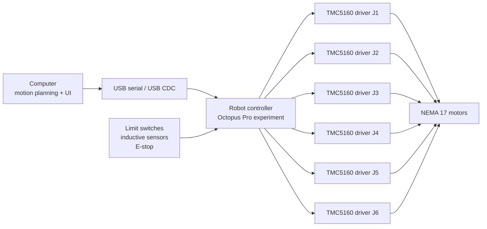
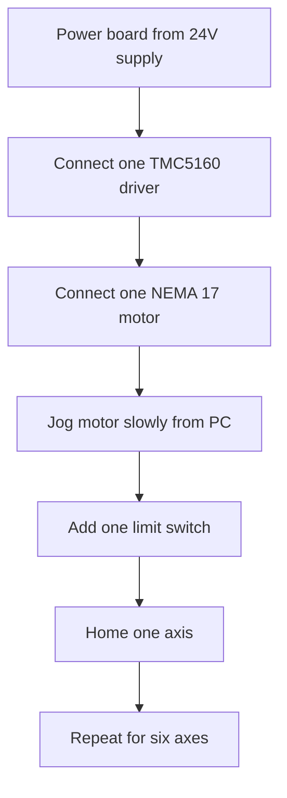

# Electronics Plan

The control architecture should keep high-level logic on the computer and low-level timing on the robot controller.

## Decisions So Far

- The existing Arduino Uno-compatible board is not the full-arm controller.
- It can still be useful for small learning tests: one servo, one driver, one limit switch, serial commands.
- The official PAROL6 control board is the easiest compatible path, but it is expensive.
- The current workaround is to test a BIGTREETECH Octopus Pro board with TMC5160 drivers.
- The computer should command poses, jogs, and trajectories over USB.
- The controller should own step timing, homing, limit switches, emergency-stop handling, and driver enable/disable.

## J5 Tool Connector Wiring

The M8 4-pin electric gripper/tool connector mounted in the J5 electronics lid is being wired as a CAN + 24V tool connector.

Use this project-specific colour convention:

| Connector label | Wire colour |
|---|---|
| GND | Green |
| CANH | Blue |
| CANL | Yellow |
| 24V | Black |

Keep CANH and CANL as a twisted pair where possible. The 24V line should come from a fused tool-power feed, not an Octopus logic/header pin.

## Simulator Parts Catalog

The simulator's Parts view has a dedicated Electronics tab containing the controller, six drivers, six motors across three body lengths, three planetary gearboxes, power supply, cooling fan, limit switches, inductive sensors, and emergency stop. Quantities follow `docs/BOM.md`, and every entry includes dimensions, planning data, a source reference, and a standalone 3D inspection model.

The BTT Octopus Pro and TMC5160 Pro are rendered from converted manufacturer STEP assemblies. The other entries are dimensioned visual models intended for layout and purchasing review rather than fabrication.

## Official PAROL6 Controller Path

The official controller is designed for PAROL6 firmware and PAROL6 Commander. It is likely the fastest way to get a working arm.

Pros:

- Lowest software integration risk
- Existing firmware expects this hardware
- Driver, sensor, and power wiring are documented by the PAROL6 ecosystem

Cons:

- Expensive
- Less learning value in controller design
- Less flexible if we want to experiment deeply

## Octopus Pro Workaround

The Octopus Pro route is cheaper and more hacker-friendly. It is also more work.

It is not mechanically drop-in compatible with the official printed electronics case. The Octopus Pro board is approximately 162 x 100 mm, while the outer envelope of `Electronics_case_v1_1.STL` is only about 109 x 59.8 x 130.5 mm. The upstream design keeps the 40 x 125.2 x 113.5 mm Mean Well DIN supply external and feeds 24 V into the arm; it is not intended to fit under that printed cover. Use a separate custom control enclosure for the board, drivers, supply, fuses, mains inlet, DIN rail and cooling; retain the stock base print where the arm structure or cable routing requires it.

Required work:

- Map six step/dir outputs to six TMC5160 drivers
- Map limit switches and inductive sensors
- Wire emergency-stop and motor enable safely
- Choose firmware strategy
- Create or adapt a USB command protocol
- Prove one motor and one sensor before scaling to all axes

Possible firmware strategies:

1. Port the PAROL6 firmware pin map to Octopus Pro.
2. Use a CNC/3D-printer motion firmware as a base and write a PC-side robot interface.
3. Write a minimal custom firmware that accepts joint targets over USB and generates step/dir motion.

The first prototype should be boring:

## Safety Rules

- Never power motors from USB.
- Use a 24V supply sized for the drivers.
- Add a real emergency stop before full-arm motion.
- Test with belts loose or joints unloaded first.
- Current-limit the drivers conservatively.
- Keep hands clear during homing and trajectory tests.
- Treat the arm as capable of hurting you even when moving slowly.
