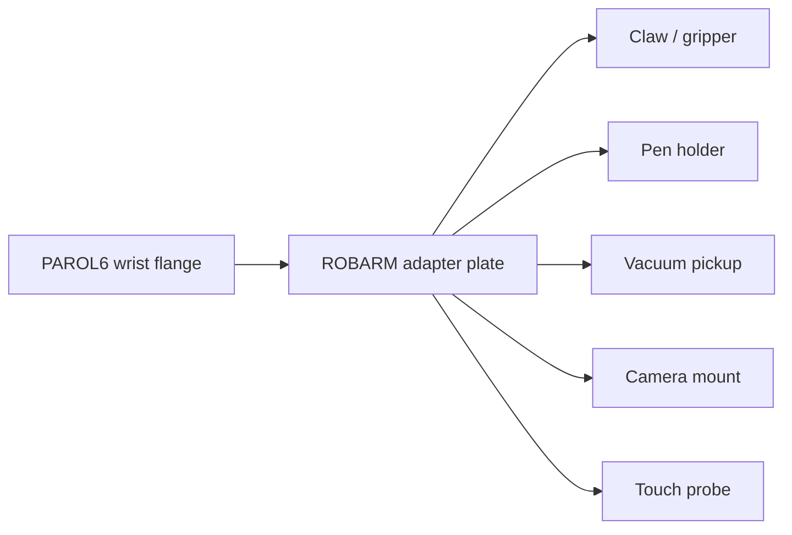

# Detachable End Effectors

The arm should not be locked into one hand. The goal is a modular wrist interface that can accept different tools.

## Tool Interface Roadmap

## Version 1: Screw-On Tool Plate

This is the first version to design.

Features:

- Bolts to the PAROL6 wrist.
- Provides a common M3 bolt pattern for all tools.
- Uses two alignment pins or printed bosses for repeatable positioning.
- Swaps with screws, not an automatic latch.
- Leaves space for a small connector or cable pass-through.

Why this first:

- Easiest to print and debug.
- Stronger than a snap-on prototype.
- Lets us build tools immediately.
- Gives us dimensions for a quick-release version later.

## Version 2: Manual Quick-Release

After the screw-on plate works:

- Dovetail or bayonet-style slide.
- Thumb screw or spring latch.
- Magnets only for alignment, not primary retention.
- Optional pogo-pin or keyed connector for tool power/signal.

## Version 3: Automatic Tool Changer

Later, if the arm is repeatable enough:

- Robot picks tools from a rack.
- Mechanical latch locks automatically.
- Electrical contacts engage through alignment pins.
- Requires homing, calibration, and tool offsets to be reliable.

## First Tools

| Tool | Purpose | Notes |
|---|---|---|
| Simple claw | Pick up small objects | Could adapt PAROL6 gripper attachments or design our own servo/stepper gripper |
| Pen holder | Drawing and calibration | Needs spring compliance so the pen does not dig into the table |
| Vacuum pickup | Move flat/light objects | Needs pump or vacuum generator, tubing, suction cup, and valve |
| Camera mount | Vision experiments | Good for computer-vision calibration and object detection |
| Touch probe | Surface mapping or button pressing | Needs a simple switch or force/compliance mechanism |

## Design Constraints

- Keep tool mass low.
- Keep tool center offset documented.
- Avoid running loose wires near the wrist roll axis.
- Make every tool define its own TCP, or tool center point.
- Keep the common adapter printable without supports if possible.
